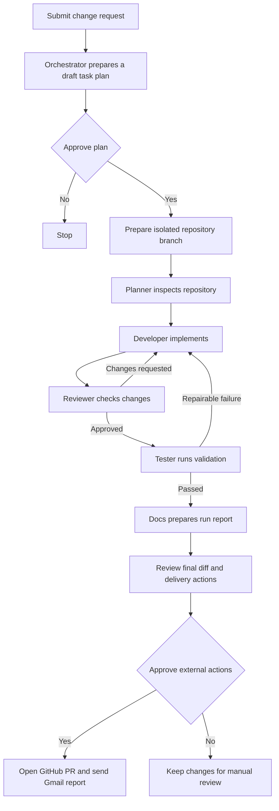

# AI Dev Team

AI Dev Team is a web application that coordinates a small, role-based software engineering team. Submit a repository change request, review the proposed plan, and follow the work through implementation, code review, tests, documentation, and an approval-gated delivery to GitHub and Gmail.

## What it does

- Runs five specialist agents - **Planner, Developer, Reviewer, Tester, and Docs** - as a LangGraph workflow.
- Uses Groq through LangChain for planning, code changes, review, and run summaries. The planner has a deterministic task-plan fallback when an LLM response cannot be used.
- Gives agents role-scoped repository, GitHub, and Gmail tools through an MCP tool layer, with an in-process fallback if an MCP server is unavailable.
- Creates an isolated repository workspace and branch for a run. Repository writes and validation commands are scoped to that workspace.
- Loops review feedback back to the Developer, with bounded review and validation attempts.
- Keeps GitHub and Gmail side effects behind human approval. A successful delivery can publish the branch as a pull request and email a PDF workflow report.
- Supports Google sign-in, per-user run history, GitHub account/repository selection, and Gmail account connections.
- Stores run, approval, evaluation, and encrypted connector credential data in MongoDB. User OAuth credentials are encrypted using a key derived from `AUTH_SESSION_SECRET`.

## Workflow



The review and validation loops are bounded. A failed check or missing implementation stops the run and reports the reason. Google sign-in and connecting Gmail are separate: sign-in creates an app session; Gmail must also be connected from **Integrations** to authorize report delivery.

## Architecture

| Area | Implementation |
| --- | --- |
| Frontend | React 18, TypeScript, Vite |
| API | FastAPI, Pydantic, Uvicorn |
| Agent orchestration | LangGraph and LangChain |
| Model provider | Groq (`GROQ_API_KEY`, `GROQ_MODEL`) |
| Persistence | MongoDB / MongoDB Atlas via PyMongo |
| Integrations | GitHub OAuth/API, Google OAuth/Gmail API |
| Tool interface | MCP servers for repository, GitHub, and Gmail tools, with direct-client fallback |
| Frontend hosting | Vercel (configured in `frontend/vercel.json`) |
| Backend hosting | Render-compatible ASGI service |

### Repository layout

```text
backend/
  app/
    agents/       Planner, Developer, Reviewer, Tester, Docs
    api/          FastAPI routes for auth, runs, approvals, tools, and integrations
    integrations/ GitHub and Gmail API clients
    mcp/          MCP server manager, clients, and role-scoped tool registry
    services/     Workflow, OAuth, credentials, execution, evaluation, and delivery
    workflow/     LangGraph state, graph, and orchestration
  tests/          Backend tests
  requirements.txt
frontend/
  src/            React application and pages
  public/videos/  Landing-page workflow video
  vercel.json     SPA routes and `/api` rewrite to the backend
docs/             Generated run reports and project documentation
```

## Requirements

- Python 3.11
- Node.js 18 or newer and npm
- A MongoDB database (MongoDB Atlas for deployment)
- A Groq API key for model-backed engineering runs
- Google OAuth credentials for app sign-in and Gmail connection
- GitHub OAuth credentials for connecting GitHub accounts and opening pull requests

## Run locally on Windows

### 1. Configure the backend

Create `backend/.env` and add the settings from the table below. Never commit this file. Use a MongoDB Atlas connection string or a local MongoDB URI. For local development, set:

```dotenv
BACKEND_PUBLIC_URL=http://localhost:8000
FRONTEND_PUBLIC_URL=http://localhost:5173
ALLOWED_ORIGINS=http://localhost:5173,http://127.0.0.1:5173
```

Create a long random session/encryption secret in PowerShell:

```powershell
python -c "import secrets; print(secrets.token_urlsafe(48))"
```

Set the output as `AUTH_SESSION_SECRET`. Keep it stable between deployments: rotating it invalidates app sessions and prevents decryption of existing stored connector tokens, so users will need to sign in and reconnect integrations.

Install dependencies and start the API from the `backend` directory:

```powershell
cd backend
python -m venv .venv
.\.venv\Scripts\Activate.ps1
python -m pip install --upgrade pip
python -m pip install -r requirements.txt
python -m uvicorn app.main:app --reload --host 0.0.0.0 --port 8000
```

If PowerShell blocks virtual-environment activation, either allow it for the current terminal with `Set-ExecutionPolicy -Scope Process -ExecutionPolicy Bypass`, or run the environment's interpreter directly: `.\.venv\Scripts\python.exe -m uvicorn app.main:app --reload --host 0.0.0.0 --port 8000`.

### 2. Start the frontend

In a second PowerShell terminal:

```powershell
cd frontend
npm ci
npm run dev
```

Open the URL printed by Vite, normally `http://localhost:5173`. In development, the frontend calls the API at `http://localhost:8000` by default. To use another API origin, set the Vite variable `VITE_API_BASE` before starting/building the frontend. The production Vercel setup uses the same-origin `/api` rewrite instead.

### 3. Connect accounts and run a workflow

1. Sign in with Google.
2. Open **Integrations**, connect GitHub and select a repository.
3. Connect Gmail if you want a final report email.
4. Submit a focused change request and approve the generated plan.
5. Follow the workflow, inspect the diff, and approve or decline the proposed external delivery actions.

The backend health endpoint is `http://localhost:8000/api/health`; interactive API documentation is at `http://localhost:8000/docs`.

## Configuration reference

All backend settings are read from environment variables (or `backend/.env` in local development). Hosting providers should receive these as service environment variables. Do not paste real values into source control, issues, or screenshots.

| Variable | Required | Purpose |
| --- | --- | --- |
| `MONGO_URI` | Production | MongoDB connection URI. Persistent MongoDB is required for durable history and per-user OAuth credential storage. |
| `MONGO_DB` | No | Database name; defaults to `ai_dev_team`. |
| `GROQ_API_KEY` | For AI runs | API key from Groq. |
| `GROQ_MODEL` | No | Groq model identifier; defaults to the value in `backend/app/config.py`. |
| `GOOGLE_CLIENT_ID` | For Google sign-in / Gmail OAuth | Google OAuth **Web application** client ID. |
| `GOOGLE_CLIENT_SECRET` | For Google sign-in / Gmail OAuth | Private Google OAuth client secret. |
| `GITHUB_OAUTH_CLIENT_ID` | For GitHub OAuth | GitHub OAuth App client ID. |
| `GITHUB_OAUTH_CLIENT_SECRET` | For GitHub OAuth | Private GitHub OAuth App client secret. |
| `AUTH_SESSION_SECRET` | Production | Long random key used to sign sessions and derive the encryption key for per-user connector credentials. |
| `BACKEND_PUBLIC_URL` | Production | Public origin used to build OAuth callback URLs. Must match how the browser reaches the API. |
| `FRONTEND_PUBLIC_URL` | Production | Public frontend origin for redirects after Google sign-in. |
| `ALLOWED_ORIGINS` | Production | Comma-separated browser origins permitted by CORS and API origin checks. |
| `GITHUB_REPO` | No | Optional default repository in `owner/name` form for unscoped/local integrations. Signed-in users choose their repository in the UI. |
| `GITHUB_TOKEN` | No | Optional server-side GitHub token for local/unscoped use. For normal multi-account use, connect GitHub through the UI. |
| `GMAIL_REFRESH_TOKEN` | No | Optional server-side Gmail refresh token for local/unscoped use. For account-specific delivery, connect Gmail through the UI. |
| `GMAIL_ACCESS_TOKEN` | No | Legacy short-lived Gmail token; it expires and is not suitable for durable delivery. Prefer OAuth connection or a refresh token. |
| `GMAIL_SENDER_EMAIL` | No | Sender address for environment-configured Gmail credentials. |
| `MCP_ENABLED` | No | Enables MCP tool-server calls when available; defaults to `true`. Direct in-process clients are used as fallback. |
| `APP_NAME` | No | API display name; defaults to `AI Dev Team`. |
| `DEBUG` | No | Debug setting; keep disabled in production. |
| `REPO_ROOT` | No | Repository root for local/unscoped repository tools. Run workspaces use isolated roots. |
| `VITE_API_BASE` | No | Frontend API origin override. Leave unset on Vercel when using the included `/api` rewrite. |

### OAuth callback URLs

OAuth callback URLs must match exactly, including scheme, hostname, path, and port. The backend builds callbacks from `BACKEND_PUBLIC_URL`:

```text
{BACKEND_PUBLIC_URL}/api/auth/google/callback
{BACKEND_PUBLIC_URL}/api/connectors/gmail/callback
{BACKEND_PUBLIC_URL}/api/connectors/github/callback
```

For local development, register the corresponding `http://localhost:8000/...` callback URLs with the OAuth providers. For the included Vercel deployment, the frontend proxies `/api/*` to Render. Set `BACKEND_PUBLIC_URL` to the public Vercel origin so the OAuth flow starts and returns through that same origin, then register the resulting callback URLs with Google and GitHub. The Google OAuth client needs both Google callback paths; the GitHub OAuth App needs its GitHub callback path. If you change domains, update the environment variable and provider console settings together, then redeploy the backend.

## Deployment

### MongoDB Atlas

Create a database user with a strong password and grant only the required database access. Add the backend host's outbound IP ranges to Atlas **Network Access**; use `0.0.0.0/0` only as a temporary connectivity diagnostic because it permits connections from any IP (authentication is still required). Put the Atlas connection string in `MONGO_URI`, URL-encoding special characters in the database password. Do not use a laptop's current IP as the only production allowlist entry; hosted services egress from their own addresses.

### Backend on Render

1. Create a **Web Service** from the repository and set its root directory to `backend`.
2. Use `pip install -r requirements.txt` as the build command.
3. Use `uvicorn app.main:app --host 0.0.0.0 --port $PORT` as the start command.
4. Add the production environment variables from the configuration table, including MongoDB, Groq, OAuth, session secret, frontend origin, and CORS origins.
5. Set `BACKEND_PUBLIC_URL` according to the callback/proxy setup described above. Keep `AUTH_SESSION_SECRET` stable across deploys.
6. After deployment, open `/api/health` on the public API origin and verify database and LLM status in the app's Integrations view.

### Frontend on Vercel

1. Import the repository as a Vercel project and set the root directory to `frontend`.
2. Use `npm run build` as the build command and `dist` as the output directory.
3. The included `frontend/vercel.json` rewrites `/api/*` to the configured Render service and routes the app pages to the SPA. If the backend hostname changes, update the rewrite destination and redeploy.
4. Set `FRONTEND_PUBLIC_URL` to the deployed Vercel origin, and ensure it is included in `ALLOWED_ORIGINS`.
5. Register all OAuth callback URLs for the deployed origin in Google Cloud and GitHub, as listed above.

For cross-origin API deployments without the Vercel rewrite, set `VITE_API_BASE` to the backend origin, add the frontend origin to `ALLOWED_ORIGINS`, and confirm cookies are sent with credentials. The same-origin rewrite is the default configuration in this repository.

## API overview

The API is rooted at `/api`. Private endpoints require a Google sign-in session cookie; health and OAuth callback endpoints are public.

| Area | Routes |
| --- | --- |
| Health and metadata | `GET /api/health`, `GET /api/healthcheck`, `GET /api/version`, `GET /api/ping` |
| Google authentication | `GET /api/auth/google/start`, `GET /api/auth/google/callback`, `GET /api/auth/me`, `POST /api/auth/logout` |
| Workflow runs | `POST /api/runs`, `GET /api/runs`, `GET /api/runs/{run_id}`, `DELETE /api/runs`, `DELETE /api/runs/{run_id}` |
| Approvals | `GET /api/approvals`, `GET /api/approvals/{approval_id}`, `POST /api/approvals/{approval_id}/decision` |
| Integrations | `POST /api/connectors/{provider}/start`, `GET /api/connectors/{provider}/callback`, `DELETE /api/connectors/{provider}`, plus GitHub repository list/selection routes |
| Agents and tools | `GET /api/agents`, `GET /api/tools`, MCP server/tool status routes |
| Evaluations | `GET /api/evaluations`, `POST /api/evaluations` |

FastAPI's generated OpenAPI reference is available at `/docs` when the backend is running.

## Validation

Run the backend suite from the repository root:

```powershell
python -m pytest backend/tests -q
```

Or, from inside `backend`:

```powershell
python -m pytest tests -q
```

Build the frontend from `frontend`:

```powershell
npm ci
npm run build
```

The automated workflow's repository command is allowlisted and runs `python -m pytest backend/tests -q` from the repository root. Validation runs in an isolated run workspace, so its current directory and available Git configuration can differ from a local terminal.

## Security and operations

- Keep `.env` files, OAuth secrets, API keys, refresh tokens, and session secrets out of Git. Rotate exposed credentials at the provider, not just in the file.
- Use HTTPS in production. The app marks auth cookies `Secure` when `BACKEND_PUBLIC_URL` uses HTTPS.
- Use a unique, high-entropy `AUTH_SESSION_SECRET` and preserve it across restarts/deploys. Back it up securely; changing it requires users to reconnect provider accounts.
- Use a dedicated MongoDB user, least-privilege database access, TLS, and a narrow Atlas network allowlist where your host provides stable egress IPs.
- Connect each user's GitHub and Gmail accounts through OAuth. Do not put personal access tokens or refresh tokens in browser code or frontend environment variables.
- Review the final diff and approval details before authorizing a pull request or email. External actions are intentionally approval-gated.
- MongoDB unavailability can trigger an in-memory fallback for workflow history; that state is temporary and not shared across service restarts/instances. Secure per-user connector storage requires MongoDB. Treat a MongoDB outage as a deployment issue and restore connectivity before relying on persistence or integrations.
- Groq quotas and rate limits can stop model-backed runs. Check the configured model/key and provider quota, then retry after the provider reset window.

## Troubleshooting

| Symptom | Check |
| --- | --- |
| `redirect_uri_mismatch` from Google or `redirect URI is not associated` from GitHub | Compare the callback shown by the app/API with the OAuth console callback character-for-character. Confirm `BACKEND_PUBLIC_URL`, Vercel rewrite destination, and deployed origin agree. |
| `Request origin is not allowed` | Add the exact frontend origin (scheme and host, no path) to `ALLOWED_ORIGINS`, then restart/redeploy the backend. |
| Google sign-in works but Gmail is disconnected | Google sign-in does not grant Gmail sending permission. Connect Gmail separately in **Integrations** and approve the requested Gmail access. |
| Gmail token rejected or expired | Reconnect Gmail through OAuth. A manually supplied access token expires; use a refresh-token flow only for local/unscoped configuration. |
| GitHub says no account/repository is connected | Configure the GitHub OAuth App credentials on the backend, connect the account in **Integrations**, and select a repository. |
| Atlas connection fails | Verify `MONGO_URI`, encoded password characters, Atlas database user permissions, and the backend host's outbound IP allowlist. |
| Runs disappear after a restart | Restore MongoDB connectivity and verify `MONGO_URI`; the in-memory fallback is not durable. |
| Agent run stops during planning, review, or validation | Open that run's stage details, fix the reported code/test or provider issue, and retry after any LLM quota limit has reset. A workflow marked failed does not create a pull request or send the final report. |

## License

No license is currently specified in this repository. Add a `LICENSE` file before redistributing the project under an open-source license.
