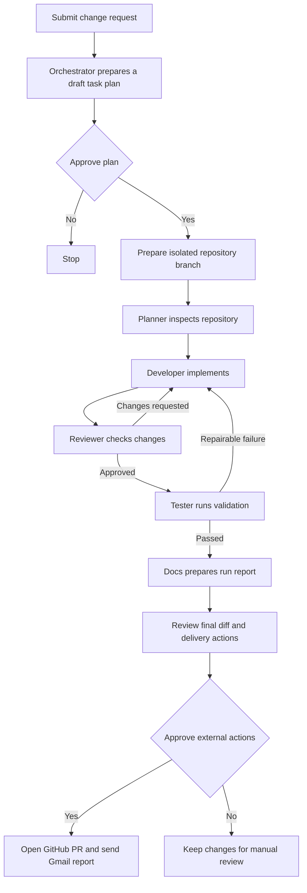

# AI Dev Team

AI Dev Team is a web application that coordinates a small, role-based software engineering team. Submit a repository change request, review the proposed plan, and follow the work through implementation, code review, tests, documentation, and an approval-gated delivery to GitHub and Gmail.

## What it does

- Runs five specialist agents - **Planner, Developer, Reviewer, Tester, and Docs** - as a LangGraph workflow.
- Uses Groq through LangChain for planning, code changes, review, and run summaries. The planner has a deterministic task-plan fallback when an LLM response cannot be used.
- Gives agents role-scoped repository, GitHub, and Gmail tools through an MCP tool layer, with an in-process fallback if an MCP server is unavailable.
- Creates an isolated repository workspace and branch for a run. Repository writes and validation commands are scoped to that workspace.
- Loops review feedback back to the Developer, with bounded review and validation attempts.
- Keeps GitHub and Gmail side effects behind human approval. A successful delivery can publish the branch as a pull request and email a PDF workflow report.
- Supports Google sign-in, per-user run history, GitHub account/repository selection, and Gmail account connections.
- Stores run, approval, evaluation, and encrypted connector credential data in MongoDB. User OAuth credentials are encrypted using a key derived from `AUTH_SESSION_SECRET`.

## Workflow



The review and validation loops are bounded. A failed check or missing implementation stops the run and reports the reason. Google sign-in and connecting Gmail are separate: sign-in creates an app session; Gmail must also be connected from **Integrations** to authorize report delivery.

## Architecture

| Area | Implementation |
| --- | --- |
| Frontend | React 18, TypeScript, Vite |
| API | FastAPI, Pydantic, Uvicorn |
| Agent orchestration | LangGraph and LangChain |
| Model provider | Groq (`GROQ_API_KEY`, `GROQ_MODEL`) |
| Persistence | MongoDB / MongoDB Atlas via PyMongo |
| Integrations | GitHub OAuth/API, Google OAuth/Gmail API |
| Tool interface | MCP servers for repository, GitHub, and Gmail tools, with direct-client fallback |
| Frontend hosting | Vercel (configured in `frontend/vercel.json`) |
| Backend hosting | Render-compatible ASGI service |

### Repository layout

```text
backend/
  app/
    agents/       Planner, Developer, Reviewer, Tester, Docs
    api/          FastAPI routes for auth, runs, approvals, tools, and integrations
    integrations/ GitHub and Gmail API clients
    mcp/          MCP server manager, clients, and role-scoped tool registry
    services/     Workflow, OAuth, credentials, execution, evaluation, and delivery
    workflow/     LangGraph state, graph, and orchestration
  tests/          Backend tests
  requirements.txt
frontend/
  src/            React application and pages
  public/videos/  Landing-page workflow video
  vercel.json     SPA routes and `/api` rewrite to the backend
docs/             Generated run reports and project documentation
```

## Requirements

- Python 3.11
- Node.js 18 or newer and npm
- A MongoDB database (MongoDB Atlas for deployment)
- A Groq API key for model-backed engineering runs
- Google OAuth credentials for app sign-in and Gmail connection
- GitHub OAuth credentials for connecting GitHub accounts and opening pull requests


